<picture>
  <source media="(prefers-color-scheme: dark)" srcset="assets/banner-dark.svg">
  
</picture>

---

## 📌 Now

- **Nov 2026:** Finished my **M.S. in Software Engineering** at WGU (Domain-Driven Design).
- **Oct 2026:** Shipped **Titan v1.6.1**, the final major release. New design, a guided setup tour, schedule change alerts, store search, and Firefox support.
- **Ongoing:** [Titan Data](https://github.com/chancechime/Titan-Data) keeps itself current with a monthly GitHub Action that finds new stores on its own.
- **Next:** Looking for **product engineering, APM, and product ops roles**. Onsite, hybrid, or remote.

---

## ✨ About Me

Computer Science grad from California State University, Northridge, with an M.S. in Software Engineering from Western Governors University focused on Domain-Driven Design.

I sit somewhere between **builder, product thinker, and "wait, why does this workflow still suck?" person**. I like turning messy problems into clean products, especially when the work involves user needs, technical tradeoffs, and shipping something people can actually use.

I own my projects end to end: scoping, building, QA, store review, and answering the support emails. I handle every Titan support request myself and use those reports to fix things at the root. I build with TypeScript, React, Python, Java, Swift, and whatever else the idea bullies me into learning at 2 a.m.

---

## 🚀 Shipped

### 🛠️ [Titan](https://titanwft.net/)
**v1.6.1** · Oct 2026 · Final major release, now in maintenance mode

A browser extension that syncs Home Depot Workforce Tool schedules into Google Calendar. Open your schedule, hit sync, and your shifts land on your calendar with the right times, role, and store address.

- **Real users:** 57 users, 22% install-click rate, and I handle all the support.
- **Only syncs what changed:** adds new shifts, updates moved ones, removes cancelled ones. No duplicates.
- **Runs everywhere:** Chrome, Edge, Firefox, and Safari, [live on the Chrome Web Store](https://chromewebstore.google.com/detail/bbmligiodjlhjljokhbmaiedcjkboakn).
- **Privacy first:** no Titan backend holding your schedule, and credentials are encrypted at rest.
- **Fixed at the root:** users reported duplicate events and my first fix didn't hold. I reproduced it with two browser profiles, gave each shift a unique fingerprint, and shipped the fix with tests.
- **Tested:** 137 unit tests covering sync logic, OAuth, calendar files, and store parsing.

**Stack:** TypeScript, React, Vite, Tailwind, Chrome Extension APIs (MV3), OAuth 2.0, Google Calendar API

---

### 🗺️ [Titan Data](https://github.com/chancechime/Titan-Data)
Live · Powers Titan's store lookup and titanwft.net

A normalized directory of **2,179 of ~2,300 Home Depot stores** that turns a store number into a full address Google Maps can open.

Once a month a GitHub Action checks Home Depot's sitemap, Overture Maps, and OpenStreetMap for new locations. Anything with every field confirmed gets committed. Anything incomplete gets emailed to me for a manual lookup instead of guessed.

**Stack:** Python, GitHub Actions, Overture Maps, OpenStreetMap

---

## 💼 Experience

- **Sales Associate, Tool Rental**, The Home Depot (Mar 2025 to Sep 2026): held a 75% Damage Protection attach rate after rewriting how coverage was explained up front.
- **Administrative Support Assistant II**, CSUN University Student Union (Oct 2023 to Jan 2025): 25% faster technical response time from a quick-action guide and student worker training.
- **Research Associate**, CSUN ARCS (Aug 2023 to May 2024): Scrum Lead for a 7-person team building a Scala 3 code generator for a NASA JPL-affiliated compiler.
- **Residential Advisor**, CSUN Student Housing (Jul 2023 to May 2024): 2024 Residential Advisor Mentor of the Year.

---

## 🧪 Building

### 📍 [Spotly](https://chancechime.dev/projects/spotly)
In progress · [Follow on Instagram](https://instagram.com/spotlyhq)

A social discovery app for finding where to go next through friends, creators, local communities, and trusted recommendations.

Think less anonymous review wall, more **"where should we go?" powered by people whose taste you actually trust**.

I wrote the PRD, designed the Figma flows, and designed a Trust Score that ranks places by relationship strength, taste, and local credibility.

**Stack:** React Native (Expo), TypeScript, Firebase, Spring Boot, PostgreSQL, Mapbox

---

### 🎮 [Oberon Remote](https://chancechime.dev/projects/oberon)
In progress · v0.1.0

Prototyping a PS5 media remote for Mac and iPhone. Built solo in SwiftUI with a Python bridge, tested on a real Mac, iPhone, and PS5.

**Stack:** Swift, SwiftUI, Python

---

## 🧰 Tech Stack

| | |
| :--- | :--- |
| **Languages** |  |
| **Frontend & Apps** |  |
| **Backend** |  |
| **Data & Cloud** |  |
| **Tools** |  |

---

## 🧩 Earlier Work

| Project | What it does | Stack |
| :--- | :--- | :--- |
| [**Effort**](https://chancechime.dev/projects/effort) | iOS screen-time app that makes you earn your apps. Archived 2026. | Swift, SwiftUI, Screen Time API, Vision |
| [**OrionDB**](https://github.com/chancechime/OrionDB) | Secure desktop store application with inventory and user management features. | Python, PyQt5, PostgreSQL |
| [**FPP + Proteus Compiler**](https://github.com/AlbertoSantana0/ProteusFPP) | Scala-based compiler work integrating Proteus and F Prime Prime in a NASA JPL research context. | Scala 3, Compiler Design |
| [**TransModus**](https://github.com/TheRealEngineers/TransModus) | Transportation management platform for organizing logistics workflows. | Spring Boot, MySQL |

---

## 🌱 What I Care About

- Building products people actually want to use
- Clean user experiences backed by solid engineering
- Turning rough ideas into shipped features
- Learning fast, asking better questions, and owning the work
- Teams that communicate well, move with purpose, and still have a little sparkle

---

### Since you made it this far, we should probably connect.

